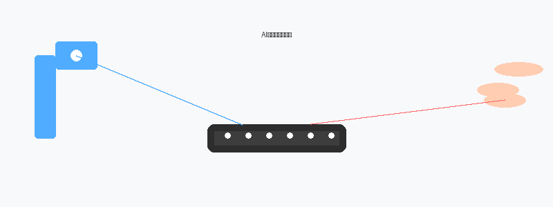
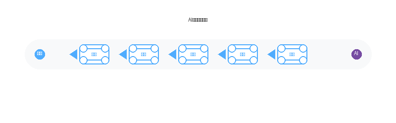
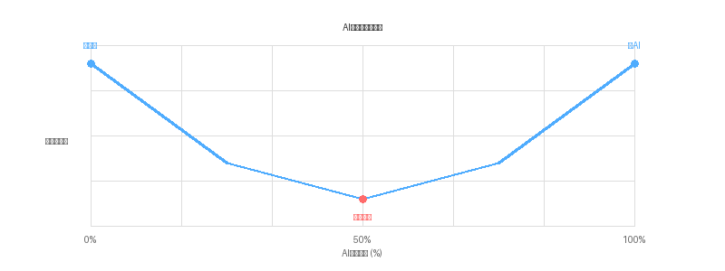
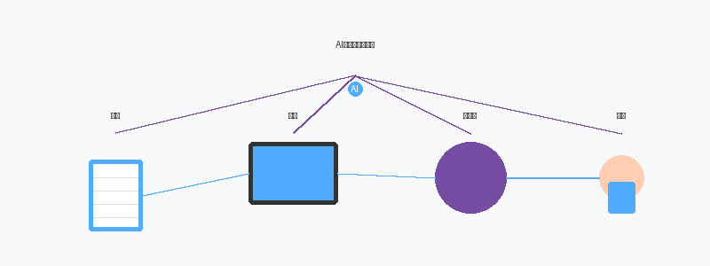

好的，没问题！作为一名优秀的科普作家，我将为你把这篇关于AI文本检测的学术论文，变成一篇既有趣又好懂的科普文章。

---

# 当AI帮你写作业：我们还能分辨出"人味"吗？

## 引言：一个"人机合著"的新时代

想象一下，你正在写一篇关于"太空殖民"的文章。你绞尽脑汁写了个开头，但感觉文笔平平。于是，你打开了AI写作助手，对它说："帮我把这段改得更生动一点。" AI瞬间给出了一个充满比喻和动感的版本。你看了看，觉得不错，但又删改了几句，让它更符合自己的风格。接着，你又让AI帮你补充了一段关于火星引力的科学解释，然后自己再润色一下……

你最后的文章是"你"写的，还是"AI"写的？答案是：**都是**。

如今，AI写作工具已经像计算器一样普及。我们不再是简单地用AI"一键生成"整篇文章，而是越来越多地采用"人机协作"的模式：人类打草稿，AI来润色、扩写、改写，人类再修改……最终的作品，就像一杯混合了多种咖啡豆的拿铁，很难分清哪一口是"人味"，哪一口是"机器味"。

这就给我们的社会提出了一个严峻的新问题：**我们还能可靠地识别出哪些文字是AI写的吗？**

传统的AI文本检测器就像一个"黑白探测器"，只能回答"这是不是AI写的"。但在一个"人机合著"的时代，这个简单的问题已经不够用了。我们需要知道：**AI到底参与了多久？参与了多深？在哪些地方动了手脚？**

最近，一群来自人工智能大学的研究人员，为了解决这个难题，搭建了一个非常巧妙的"实验室"——**OpAI-Bench**。今天，我们就来一起参观这个实验室，看看他们发现了什么有趣的现象。

## 核心内容：一个"渐进式改造"的实验

这个实验室的奇妙之处在于，它不像以前那样只盯着一个"成品"看，而是完整地**记录了从"纯人工"到"高度AI化"的整个改造过程**。

### 1. 实验是怎么做的？

科学家们找来了一堆"纯人类"写的文章，覆盖了新闻、小说、学术摘要等多个领域。然后，他们扮演一个"耐心的编辑"，让AI对这些文章进行**五种不同风格的"手术"**：

*   **打磨 (Polish)**：就像给家具上蜡，让句子更流畅，修正语法错误，但基本不改动原意。
*   **改写 (Paraphrase)**：换一种说法，好比用"哎呀，我的钱包丢了"代替"我的资财遗失了"。
*   **风格改写 (Style Rewrite)**：彻底改变文风，比如把一段严谨的学术描述改成俏皮的网络段子。
*   **压缩 (Compress)**：删繁就简，提炼出核心信息。
*   **扩写 (Expand)**：添油加醋，补充更多细节和背景信息。

最关键的是，他们并不是一次性把文章改完，而是**分了9个步骤**，每一步都让AI改动更多的内容。从第一步只改动20%的句子（V1），到最后一步几乎全部由AI改写（V8）。这样一来，他们就得到了9个版本的"人机混合体"。

### 2. 发现了什么惊人的现象？

然后，他们用各种AI文本检测器来测试这些"混合体"，结果发现了一个反直觉的现象：

**最"狡猾"的文本，往往不是那些被AI改得面目全非的，也不是那些纯人类写的，而是那些处于"中间状态"的。**

我们来打个比方。想象一个水池，一边是纯清水（人类文本），另一边是纯墨水（AI文本）。传统的检测器就是一张试纸，能轻松分辨清水和墨水。

但我们的实验是，一滴一滴地向清水中加入墨水。起初，水很清澈（V0-V1），试纸测试就是"人类"。随着墨水越加越多，水开始变灰（V2-V4），这时候试纸就有点拿不准了，觉得"有点像墨水，又有点像清水"。等到墨水加得足够多，水变得全黑（V8），试纸又能确定地说"这是墨水"。

**是的，最让检测器犯难的，正是那些"半灰不灰"的混合体！** 尤其是当AI只做了"压缩"操作，并且改写了大约40%-50%的内容时，所有检测器都表现最差，误判率最高。

这个发现非常重要，因为它揭示了AI文本检测的一个关键盲区：**我们以前只关注"终点"，却忽略了"过程"**。在实际生活中，大多数人使用AI的方式正是这种"渐进式"的，而非"一键生成"。这意味着，我们目前最先进的检测器，在面对最真实的AI使用场景时，恰恰是最脆弱的。

### 3. 为什么"混合体"这么难检测？

科学家们分析认为，这可能是因为"混合体"同时具备了人类文本和AI文本的某些特征，但又都不纯粹。

*   比如，被AI"打磨"过的句子，虽然更流畅了，但词汇选择可能还保留着人类的痕迹。
*   被AI"扩写"的部分，可能结构工整，逻辑严密，但和人类自己写的上下文衔接处，又会显得"格格不入"。

这种"你中有我、我中有你"的混乱状态，让检测器无法找到明确的"机器味"信号。就像你吃一道"分子料理"，你很难分辨出哪个部分是土豆，哪个部分是鱼子酱，因为它们的形态和味道已经完全融合了。

## 研究意义与影响：我们该如何应对？

这项研究的意义，绝不仅仅是发表一篇论文那么简单。它为我们敲响了警钟，也指明了未来的方向。

1.  **对教育界**：老师不能再简单地认为"AI检测结果是红色就一定是抄袭"。一个学生可能只是用AI润色了几个句子，就可能导致误判。未来的评估方式可能需要改变，比如更注重写作过程的记录，或者鼓励学生展示"人机协作"的成果，并反思自己的创造性贡献。

2.  **对内容平台**：像新闻网站、学术期刊、博客平台等，需要对内容进行更精细的管理。一个"全是AI生成"的博客可能需要限制，但一个"AI辅助优化"的新闻报道，或许可以接受。未来的审核工具需要能提供更丰富的信息，比如"AI参与度百分比"、"AI参与了哪些操作"等。

3.  **对AI开发者**：这个研究提供了一个绝佳的测试平台。开发者可以借此测试自己的检测器有多"抗揍"，看看它在面对不同编辑操作、不同混合比例时的表现。这有助于开发出更鲁棒、更智能的新一代AI文本检测器。

4.  **对普通用户**：我们需要对"AI写作"这件事有更清醒的认知。AI是一个强大的辅助工具，但最终，文章的灵魂——观点、情感和创造力——依然来自人类。与其纠结于如何"骗过"检测器，不如思考如何更好地利用AI，提升自己的思考和表达能力。

**总结一下，** OpAI-Bench这个实验室告诉我们一个朴素的真理：**真实的世界不是非黑即白的，而是充满渐变的灰色。** 在AI时代，一个更有效的方法不是去"消灭"AI痕迹，而是去"理解"它，并学会与它共存。未来的AI文本检测，将不再是一个简单的"是或否"的判断题，而是一道复杂的"人机协作程度"的分析题。

这或许才是我们真正需要迎接的挑战和机遇。